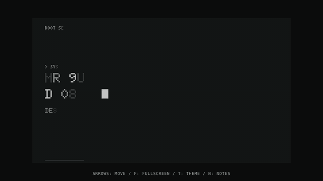

# Dot Board

An animated dot-matrix presentation engine. The whole 16:9 slide is one dot screen, like an e-reader running a split-flap departures board. Text is never set in a font: it is written by lighting dots on a 384 x 216 grid, and headlines arrive with a split-flap animation where every changing dot flips like a disc.



Designed and built by [Julie Torrisi-Coffey](https://julietorrisi.com). The deck is the proof of craft: a visual system shipped as running code.

## Run it

```bash
npm install
npm run dev      # local deck at http://localhost:5173
npm test         # unit tests: grid math, glyphs, wrapping, slot diffing, flips, API helpers
npm run check    # guardrails for a deck file (see below)
npm run build
```

## Present it

| Key | Does |
|---|---|
| Arrow keys, space, click | Next or previous slide (click the left third to go back) |
| A | Jump to Ask the Board |
| F | Fullscreen |
| T | Dark or light theme (dark is the default) |
| N | Speaker notes in a second window, kept in sync |

Every slide has a hash URL (`#boot`, `#ask`, `#departures`) for deep links. After the first load, the deck works offline through a service worker.

## One engine, any deck

A deck is a JSON file. The engine loads `deck.json` from the same folder as the page, and falls back to the demo deck in `src/decks/demo.json`. To make a new talk, write a new `deck.json`: no code changes.

Slide templates:

| Template | Use |
|---|---|
| `boot` | Opening line with a blinking cursor |
| `section` | Big section number, title and two supporting lines |
| `statement` | One to three H1 lines, optional body and note. `prompt: true` adds the `>` prompt. |
| `readout` | Three big stats with labels and a source line |
| `departures` | Four rows of code, project and status, like a departures board |
| `image` | One real screen inside a grid-aligned frame. It dissolves in from dots. |
| `wall` | A grid of real screens, for showing volume. Set `columns` to put tall phone screens in one row. |
| `ask` | The AI icebreaker |
| `eof` | Closing line and contact details |

`npm run check path/to/deck.json` fails the build on em dashes, characters the board can't draw, text past the margin, missing alt text, or a departures status outside SHIPPED, LIVE, PUBLISHED, SUBMITTED, PROTOTYPE and IN PROGRESS.

## Ask the Board

A slide where the audience types a prompt and the reply flaps onto the board.

- `api/ask.ts` is a Vercel function that calls Claude (`claude-haiku-5-5` by default, override with `ASK_MODEL`).
- The API key is read from the `ANTHROPIC_API_KEY` environment variable on the server. It is never in client code or this repo.
- Input is capped at 120 characters, requests are rate limited per IP, and calls time out after 6 seconds. Any failure flaps a canned reply.
- Private decks hosted elsewhere can share this endpoint: set `askEndpoint` in their `deck.json` to this site's `/api/ask`, and list their origins in `ASK_ALLOWED_ORIGINS` (comma separated). The key stays in one place.
- With no network, or no API deployed, the slide cycles the deck's prewritten `offlineReplies`, so the live moment never dies.

## The spec

### Screen

| Property | Value |
|---|---|
| Logical canvas | 1920 x 1080 |
| Grid | 384 columns x 216 rows |
| Pitch | 5px, with a 4px dot and a 1px gap |
| Margins | 19 cells left and right. Content spans col 19 to col 364. |

Every lit dot sits exactly on an unlit screen dot. To stay crisp at any size, the renderer picks an integer device pitch, `p = max(2, floor(min(vw*dpr/384, vh*dpr/216)))`, draws the grid at that pitch, and letterboxes the rest.

| Token | Dark (primary) | Light |
|---|---|---|
| Background | #0E0E0D | #ECEAE5 |
| Unlit dot | #201F1D | #DDDBD6 |
| Grey (secondary text) | #8F8C85 | #5C5954 |
| Ink (primary text) | #ECEAE5 | #1E1E1C |

There is no accent color. Hierarchy comes from size, and from ink versus grey.

### Type

Two bitmap faces in four sizes, each a whole multiple of the dot:

| Role | Face | Scale | Height | Advance |
|---|---|---|---|---|
| Hero | 5x7 | x3 | 21 rows | 18 cells |
| H1 | 5x7 | x2 | 14 rows | 12 cells |
| Body | 5x7 | x1 | 7 rows | 6 cells |
| Label | 3x5 | x1 | 5 rows | 4 cells |

Text width in cells is `(chars x (glyphWidth + 1) - 1) x scale`. All text is uppercase, and unknown characters render blank.

### Motion

- **Slots.** Every character position is a slot keyed by role, column and row. Only slots whose character changes will flip, so the header stays still and the page number flips just the digit that changes.
- **Flap.** A changing slot cycles 6 to 12 random glyphs at 78ms each, then lands on its target. Each slot starts after `(row / 216) x 260ms + charIndex x 34ms`.
- **Dot flip.** Each changing dot flips around its horizontal axis, and the flip travels down the glyph row by row.
- **Progress bar.** It fills one dot at a time, 2.5ms apart, and doubles as reading progress.
- **Cursor.** Blinks every 530ms.
- **Reduced motion.** With `prefers-reduced-motion`, slides swap instantly.

## Deploy

Vercel builds `main` to production and gives every pull request a preview link. Set `ANTHROPIC_API_KEY` under Project, Settings, Environment Variables.

## License

MIT
